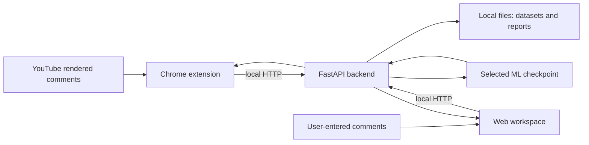

# Mozhi presentation guide and speaking notes

_Prepared from this repository and its saved reports on 3 November 2026. Suggested length: 12–15 minutes plus questions. Adjust the wording to sound natural when you speak. The default local runtime uses the baseline checkpoint when that checkpoint is present. Check `/api/status` immediately before a live demo to identify the model actually serving predictions._

## The one-minute version

> Mozhi is a local research prototype for detecting broadly offensive language in English, Tamil, and Tamil-English code-mixed comments. It has a web workspace for analyzing text and reviewing data, and a Chrome extension that annotates comments currently loaded on a YouTube video page. The default model is a calibrated TF-IDF and logistic-regression baseline. I also trained an experimental MuRIL transformer on a GPU. The project is built around measurement: it shows predictions, compares models on held-out data, helps a human inspect suspicious labels, and documents where the models still fail. A flag is a model prediction, not proof that a comment is harmful, and the binary label is not a dedicated hate-speech category.

## Key facts to remember

| Topic | Answer to give |
| --- | --- |
| Frontend | Plain HTML, CSS, and JavaScript web app; Chrome Manifest V3 extension. |
| Backend | Python 3.12, FastAPI, Pydantic, Uvicorn on local `127.0.0.1:8000`. |
| Database | None. Data, reports, and models are local CSV, JSON, joblib, and safetensors files; Chrome stores the extension switch locally. |
| Default model | Word and character TF-IDF + class-weighted logistic regression + sigmoid calibration. |
| Optional model | Fine-tuned `google/muril-base-cased` (MuRIL), exported separately after GPU training. |
| Output | Broad offensive-language probability, `toxic`/`non_toxic` threshold label, 0–10 likelihood score, and context marker. |
| Baseline result | 74.08% test macro-F1; 78.47% toxic precision; **46.38% toxic recall**; 4.15% false-positive rate on original published labels. |
| Transformer result | 89.62% macro-F1 on a mixed-source test set; **77.57%** on its DravidianCodeMix source slice. These are not a controlled head-to-head result against the baseline. |
| Extension scope | Comments and replies currently rendered on a YouTube watch page; not all comments on the video. |
| Primary caveat | Published labels are not independently human-verified in this project; performance on new videos and separately identified Thanglish remains unproven. |

## Suggested slide deck and words to say

### Slide 1 — Title and purpose (about 45 seconds)

**Show:** “Mozhi: English, Tamil and Thanglish offensive-comment analysis,” one web-app screenshot, and one extension screenshot.

**Say:**

> This project is called Mozhi. It analyzes comments in English, Tamil, and code-mixed Tamil-English, including romanized Tamil often called Thanglish. I built it as a local research prototype with two user interfaces: a web workspace for experiments and a Chrome extension for comments visible on YouTube. The project predicts a broad offensive-language label. I will explain how comments move through the system, how the models were evaluated, and why the results need careful interpretation.

### Slide 2 — Problem and task definition (about 1 minute)

**Show:** A harmless greeting beside a direct insult, plus “binary offensive language ≠ hate category ≠ severity.”

**Say:**

> Comment sections are difficult because Tamil script, English words, romanized Tamil, slang, spelling changes, and context appear together. A model can learn the wrong associations from a narrow dataset. For example, our original baseline assigned similar likelihoods to “Hi how are you” and “fuck off.” My task definition is binary offensive-language classification: zero means non-offensive according to the training labels, and one means offensive or abusive according to those labels. This is wider than identity-based hate speech. It is also different from sentiment: a critical comment can be negative without being abusive.

**If asked about fixed outputs:** The model is deterministic for a fixed input and saved checkpoint. There is no hardcoded list that maps particular phrases to flags. Label mappings, probability thresholds, input limits, and emoji display bands are defined in code.

### Slide 3 — Architecture and tech stack (about 1 minute)

**Show:** This diagram or a simplified version of it.



**Say:**

> The architecture has a plain HTML, CSS, and JavaScript web frontend, plus a Manifest V3 Chrome extension. Both call the same FastAPI backend on `127.0.0.1:8000`. The backend validates each request, loads the selected local model, runs inference, and returns probabilities, labels, and summary statistics. We do not use a database; datasets and reports are local CSV and JSON files, and the checkpoints are local model files. Inference does not call a cloud model, translation service, or generative LLM. This is a local, single-user research design, not a deployed multi-user moderation service.

### Slide 4 — User workflow: web app and extension (about 1 minute)

**Show:** Two lanes: “paste comments → analyze → inspect/export” and “open video → toggle ON → annotate visible comments.”

**Say:**

> In the web app, a user pastes one comment per line, runs analysis, filters flagged or context-sensitive results, and can export a CSV. The workspace also exposes dataset loading, model experiments, and human label review. In the extension, the user opens a YouTube watch page and turns page indicators on. The content script watches comments as YouTube renders them, waits about 1.4 seconds after page changes, and sends batches of no more than 100 comments through the extension's service worker to the local API. It attaches emoji and likelihood percentages beside each matched comment and updates a small summary. The popup also has manual analysis for up to 500 loaded comments. The extension only sees rendered comments, so its totals are a sample, not a census of the whole video.

### Slide 5 — Dataset and labeling pipeline (about 1–1.5 minutes)

**Show:** Source → label mapping → cleaning → duplicate/group checks → train/calibration/validation/test.

**Say:**

> The baseline starts from the official DravidianCodeMix Tamil offensive-language comment splits. We map `Not_offensive` to the negative class, the offensive categories to the positive class, and exclude `not-Tamil` rows rather than silently calling them safe. We normalize and validate text, remove conflicting or repeated examples, and group obvious spelling variants to reduce leakage between partitions. The saved baseline dataset has 33,218 training rows, 2,094 calibration rows, 2,093 validation rows, and 4,217 test rows. These are published labels; we did not independently verify every annotation.

> The separate transformer experiment adds an English hate/offensive tweet dataset often called the Davidson dataset. Its original numeric labels mean something different, so we explicitly map hate and offensive to the positive class and neither to negative. The expanded dataset has 66,180 saved rows. The English tweet source is heavily skewed toward offensive examples. This matters when we interpret the transformer's overall score.

**Clarification:** Corpus-level “Tamil-English” metadata does not distinguish every English comment from romanized Tamil. Latin script alone is not a reliable Thanglish label.

### Slide 6 — Baseline training pipeline (about 1–1.5 minutes)

**Show:** Word TF-IDF and character TF-IDF → logistic regression → sigmoid calibration → validation threshold → held-out test.

**Say:**

> The baseline compares three configurations: word TF-IDF, word plus character TF-IDF, and the combined model with spelling augmentation applied only to training examples. TF-IDF turns text into weighted word and character features. Word unigrams and bigrams capture short phrases; three-to-five-character features help with spelling variation and romanized text. A class-weighted logistic-regression classifier learns from those features. We fit probability calibration on a separate calibration partition. Validation chooses the operating threshold and the configuration with the best macro-F1. Only after that do we inspect the held-out test result. This separation is important because choosing a model or threshold from test results would make the reported test score overly optimistic.

> The selected model is word plus character TF-IDF with training-only augmentation. Its threshold is 0.60. The augmentation is synthetic and inherits the original label; it is useful for a stress test, but it does not prove the model understands new slang.

### Slide 7 — Transformer experiment (about 1 minute)

**Show:** MuRIL encoder → fine-tune on GPU → select epoch on validation → temperature calibration → threshold selection → export.

**Say:**

> To improve language coverage, I also fine-tuned `google/muril-base-cased`, a pretrained multilingual encoder, using the expanded corpus. The training report records three epochs on CUDA, with epoch two selected from validation results. Training samples source/class combinations more evenly so the English tweet source does not dominate each batch. We fit a temperature value on calibration data, select a 0.74 threshold on validation, then evaluate the held-out test set and export model weights, tokenizer, and metadata. The exported checkpoint is in a separate runtime folder. It is an experiment, not automatically the model used by the default local app.

**Demo constraint:** The trained weights are Git-ignored because they exceed GitHub's normal file-size limit. In this Windows environment, application control previously blocked a PyTorch DLL. Do not promise a live transformer demo unless `/api/status` confirms the transformer backend and local inference works.

### Slide 8 — Inference and what a score means (about 1 minute)

**Show:** Input → model probability `p` → threshold → label; `score = 10 × p`.

**Say:**

> At inference time, the same backend serves the web app and extension. It checks input length, runs the active checkpoint, and returns an estimated positive-class probability. The 0–10 score is ten times that probability. It is a likelihood display, not an abuse-severity scale. A label is positive when probability meets the saved threshold. We also mark outputs near the threshold as needing context. For the transformer, inputs cut off at its token limit are marked for review as well. This marker is a simple rule and will not catch every confident error. The baseline may show positively associated word or character features; those are statistical associations, not verified toxic spans or a causal explanation.

### Slide 9 — Evaluation metrics: what each tells us (about 1–1.5 minutes)

**Show:** Small confusion matrix and the definitions below. Use “positive = offensive” for every formula.

| Metric | Plain-language meaning | Formula |
| --- | --- | --- |
| True positive (TP) | Labeled offensive and flagged | Count |
| False positive (FP) | Labeled non-offensive but flagged | Count |
| False negative (FN) | Labeled offensive but missed | Count |
| True negative (TN) | Labeled non-offensive and not flagged | Count |
| Precision | Of flagged comments, fraction labeled offensive | `TP / (TP + FP)` |
| Recall | Of offensive-labeled comments, fraction caught | `TP / (TP + FN)` |
| False-positive rate | Of non-offensive-labeled comments, fraction wrongly flagged | `FP / (FP + TN)` |
| F1 | Balance of precision and recall for one class | `2 × precision × recall / (precision + recall)` |
| Macro-F1 | Mean of F1 for the offensive and non-offensive classes | `(F1_positive + F1_negative) / 2` |
| Brier score | Mean squared error of predicted probabilities against 0/1 labels; lower is better | `mean((p − y)²)` |
| ROC-AUC | How often a positive example ranks above a negative across thresholds | Area under ROC curve |

**Say:**

> Accuracy alone would hide important errors, especially with unequal class proportions. Precision tells us how many flags agree with positive labels; recall tells us how many positive-labeled comments we find. The false-positive rate describes how often benign-labeled comments are flagged. F1 balances precision and recall. Macro-F1 averages both classes so one class cannot completely dominate the score. The Brier score looks at probability quality, not just the final label. ROC-AUC measures ranking over many possible thresholds, but it does not tell us the errors at the deployed threshold. I always show the threshold and confusion matrix with the summary metrics.

### Slide 10 — Results and interpretation (about 1–1.5 minutes)

**Show:** Two clearly labeled tables, one for the baseline and one for transformer slices. Do **not** draw a single improvement arrow between their overall scores.

| Baseline: original DravidianCodeMix test | Value |
| --- | ---: |
| Test rows | 4,217 |
| Macro-F1 | 74.08% |
| Toxic precision | 78.47% |
| Toxic recall | **46.38%** |
| False-positive rate | 4.15% |
| Confusion matrix (TN / FP / FN / TP) | 3,048 / 132 / 556 / 481 |

| Transformer: expanded mixed-source test | Rows | Macro-F1 | Toxic recall |
| --- | ---: | ---: | ---: |
| Overall | 9,129 | 89.62% | 90.27% |
| Davidson English tweets | 4,910 | 92.44% | 95.82% |
| DravidianCodeMix source | 4,219 | **77.57%** | **68.43%** |
| Tamil-script slice | 599 | 75.41% | 58.82% |

**Say:**

> The baseline's 74.08% macro-F1 hides a major weakness: recall for the offensive class is only 46.38%. It missed 556 of 1,037 positive-labeled test comments. The transformer report gives a higher 89.62% overall macro-F1, but that test combines the Tamil-English corpus with a different, heavily offensive English tweet corpus. On the DravidianCodeMix source alone, the transformer reports 77.57% macro-F1. We cannot claim that 89.62 versus 74.08 is a controlled model improvement, because the data mixtures differ and even the source-slice row counts are not exactly identical. The honest takeaway is that the transformer is a promising experiment, while Tamil and especially Thanglish robustness still needs focused evaluation.

**Extra diagnostic if time allows:** The separate hand-authored set has 40 cases, 39 scored. Its 12 Thanglish cases give about 37.78% macro-F1 and 20% positive recall. That is too small to estimate population performance, but it exposes concrete failure examples. It is not an independently validated benchmark.

### Slide 11 — Human review and limitations (about 1 minute)

**Show:** “Model finds candidates → human checks labels → retrain → independent test” and four limitations.

**Say:**

> Mozhi includes a Cleanlab-assisted review workflow. It fits models on separate training folds, ranks suspicious training labels, and presents candidates to a reviewer. Nothing is changed automatically. A person decides whether to keep or correct a label, and test labels are protected from this editing workflow. After correction, we retrain and evaluate again. The limits are important: published annotations are not independently checked here; domain shift between tweets and YouTube can change errors; Latin-script comments are not automatically identifiable as English or Thanglish; and the extension sees only rendered comments. Neither a high probability nor an emoji is proof of harmful intent.

### Slide 12 — Demo and conclusion (about 1 minute)

**Show:** Live web analysis and the extension, or screenshots if the live site is slow. End with the next experiment.

**Say:**

> To conclude, Mozhi connects data preparation, model training, evaluation, human label review, local inference, and a YouTube interface in one project. The system is functional, but the research result is also its limitations: a credible classifier needs reviewed labels, realistic language-specific tests, and measurement on new videos. My next step is to create an independently annotated English, Tamil, and Thanglish test set, compare both models on the exact same held-out comments, and target the false positives and false negatives we have already found.

## Workflows to explain on a whiteboard

### A. Dataset-to-model pipeline

```text
Original labeled sources
    → explicit label mapping and source metadata
    → text validation and normalization
    → remove conflicting duplicates and obvious variant overlap
    → train / calibration / validation / held-out test partitions
    → train candidate model(s)
    → calibrate probability on calibration data
    → choose checkpoint/threshold on validation data
    → measure once on the held-out test data
    → save model and report
```

**Explain the four partitions:** Training fits feature weights or neural weights. Calibration adjusts probability scale. Validation chooses model/epoch and operating threshold. Test estimates performance after those choices are frozen. Grouping variants reduces obvious leakage, but author, topic, and semantic duplication may remain.

### B. Live comment-inference pipeline

```text
Rendered comment or pasted line
    → web UI / extension content script
    → extension service worker if from YouTube
    → POST /api/analyze with validated batch
    → active local checkpoint
    → probability, threshold label, 0–10 score, context marker
    → UI result and sample summary
```

**Explain the extension details:** OFF is the saved default. ON watches the YouTube watch-page DOM with a `MutationObserver`. It debounces changes by about 1.4 seconds, avoids duplicate annotation, batches at most 100 comments per request, matches responses back to the submitted text, and clears old results during video navigation or when switched OFF. Only visible/rendered comments enter this pipeline.

### C. Human label-review pipeline

```text
Training rows only
    → group-separated out-of-fold predictions
    → Cleanlab ranking of possible issues
    → reviewer keeps or changes each label
    → review history saved locally
    → retrain and compare on untouched held-out data
```

**Explain why the reviewer matters:** A low label-quality score means “inspect this example,” not “the label is definitely wrong.” No automatic relabeling occurs.

## Live demo run sheet

1. Start the backend from the repository root with `.\.venv\Scripts\python.exe run.py` and keep that terminal open.
2. Open `http://127.0.0.1:8000/api/status`. Confirm `model_ready: true`; read the `backend` value aloud so the audience knows which checkpoint is running.
3. Open the web app. Paste a few clearly different examples. Show the label, probability-derived score, **Needs context**, filters, and CSV export. Do not promise that any particular phrase will be correctly classified.
4. Open a YouTube `/watch?v=...` page, scroll to comments, open the Mozhi popup, and turn **Page indicators** ON. Show one inline indicator, expand it, and point to the page summary. Mention that the count is only for loaded comments.
5. If YouTube markup or the local server interrupts the live demo, use screenshots and the saved model reports. Be explicit that screenshots show the interface while the metric tables come from held-out reports.

## Likely questions and concise answers

**Q: Is this a hate-speech detector?**  
**A:** The implementation predicts a broad binary offensive-language label. Some source labels include targeted insults, but there is no separate identity-based-hate classifier or severity model.

**Q: Why can a harmless greeting get a high score?**  
**A:** The baseline learned statistical correlations from a narrow corpus, including ordinary words that happened to correlate with positive labels. A threshold change alone cannot teach context. Better reviewed data and targeted evaluation are needed.

**Q: Are words or flags hardcoded?**  
**A:** There is no phrase-to-label lookup in inference. The learned model produces probabilities. The code defines label mappings, saved threshold use, input validation, and emoji display ranges. Identical inputs usually produce identical outputs with a fixed checkpoint.

**Q: Why not report accuracy alone?**  
**A:** Accuracy can look good while missing many abusive-labeled comments or falsely flagging benign ones. We report macro-F1, precision, recall, false-positive rate, calibration-related measures, and confusion counts.

**Q: Did the transformer improve the baseline?**  
**A:** Its report is promising, but the headline numbers use different dataset mixtures. We need both models evaluated on the same independently reviewed held-out set before making a controlled improvement claim.

**Q: Why is the transformer not running in every demo?**  
**A:** The GPU export is separate from the default runtime and its large weights are not in Git. The previously tested Windows environment also blocks a PyTorch DLL. The default baseline is the reliable local demo until an approved transformer runtime is available.

**Q: Where is the database?**  
**A:** There is none. This is a local prototype that stores datasets, reports, review history, and checkpoints as files. A production multi-user system would need different storage and access controls.

**Q: Does the extension read all YouTube comments?**  
**A:** No. It reads comments rendered in the current watch page as the user scrolls or expands replies. Its summary is about that analyzed sample only.

**Q: What are the main ethical or technical risks?**  
**A:** Unverified annotations, English-source bias, domain shift, weak Thanglish coverage, and confident context errors. The predictions should support human inspection, not punishment or automatic moderation.

## Exact evidence to cite in slides

- Baseline selection, split, confusion matrix, and metrics: [`runtime/reports/experiment.json`](runtime/reports/experiment.json) on a machine with the local report, and [MODEL_CARD.md](MODEL_CARD.md). The report file is generated/ignored by Git, so the model card is the portable summary.
- GPU experiment and source/script slices: [`runtime/gpu_run/models/transformer/report.json`](runtime/gpu_run/models/transformer/report.json). The weight file is ignored by Git, but the report is tracked.
- Hand-authored diagnostics and limitations: [`runtime/gpu_run/reports/diagnostics.json`](runtime/gpu_run/reports/diagnostics.json) and [ROBUSTNESS.md](ROBUSTNESS.md).
- Full system context, API, model limitations, and file map: [PROJECT_CONTEXT.md](PROJECT_CONTEXT.md).
- Setup and extension demonstration steps: [README.md](README.md).

_Final presentation rule: state which model `/api/status` reports during the demo, identify the dataset beside every metric, and say “predicted offensive-language likelihood” instead of “toxicity severity.”_
