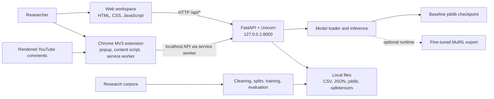

# Mozhi: complete project context and presentation brief

_Repository snapshot: 28 October 2026. This document describes code and artifacts present in this checkout. The local API was not responding during this documentation pass, so the currently running model could not be confirmed from `/api/status`. The user has confirmed that the Chrome extension works in their browser._

## 1. Executive summary

Mozhi is a local research application for classifying **offensive or abusive language** in English, Tamil, and Tamil-English code-mixed comments (often called Thanglish when written in Latin letters). A Python backend serves a browser-based research workspace and a Chrome extension for comments currently rendered on YouTube watch pages. The output is a binary `toxic` / `non_toxic` prediction, a probability-derived 0–10 likelihood score, and a threshold-based flag. It does **not** identify hate speech as a separate category, measure severity or sentiment, or make a reliable moderation decision without human review.

There are two model tracks in the repository:

1. **Packaged baseline, active with the default runtime:** word and character TF-IDF features, class-weighted logistic regression, and sigmoid probability calibration. Its checkpoint is `runtime/models/model.joblib`. Its published-label test macro-F1 is **74.08%**, toxic precision **78.47%**, and toxic recall **46.38%**.
2. **Exported GPU experiment, stored separately:** fine-tuned `google/muril-base-cased` transformer in `runtime/gpu_run/models/transformer/`. Its mixed-source test macro-F1 is **89.62%**, but the DravidianCodeMix source slice is **77.57%** and a small hand-authored Thanglish diagnostic slice is weak. The exported model is **not** in the default `runtime/models/transformer/` location. Loading it requires PyTorch and Transformers; the previously observed Windows application-control policy blocks the local Torch DLL. Its artifact and metrics should not be presented as proof that the normal Windows extension currently uses this model.

Both models produce learned predictions. There is no hardcoded list of offensive phrases in the inference path. The system does hardcode **label mappings, decision thresholds, input limits, and display rules**. Repeated input to the same fixed model will normally return the same result; deterministic prediction is expected and does not imply that phrases are hardcoded.

## 2. Problem, scope, and terminology

Social-media comments mix Tamil script, English, and romanized Tamil, often with slang and altered spellings. A narrow code-mixed training set can learn misleading word correlations: the baseline assigns a similar likelihood to an ordinary greeting and a direct insult. The project aims to make this failure measurable, improve the data and model, and expose predictions with context instead of treating a flag as fact.

| Term in the product | Meaning in this project |
| --- | --- |
| `toxic` / flagged | Predicted positive class for the project's broad offensive-language label, at or above the selected threshold. |
| `non_toxic` | Predicted negative class; it is not a guarantee of safety. |
| Probability and 0–10 score | Predicted offensive-language likelihood and `10 × probability`, rounded for display. The score is not intensity or harm severity. |
| Needs context | Prediction within 0.1 probability of the threshold, or a transformer input truncated at its token limit. This is a heuristic, not a formal uncertainty estimate. |
| Hate speech | A narrower concept involving protected identity. The binary model has no dedicated identity-based-hate output. |
| Sentiment | Positive/negative emotional tone; not the target label. |

The intended use is a local academic demonstration, error analysis, and human-supported review. Do not describe the output as a validated hate-speech detector, a complete video census, or a production moderation system.

## 3. System architecture and technology stack



| Layer | Implementation |
| --- | --- |
| Web frontend | Plain HTML, CSS, and JavaScript in `web/`; `fetch` calls to the local API. No React or frontend build step. |
| Browser extension | Chrome Manifest V3 in `extension/`: popup, background service worker, dynamically injected content script, `chrome.storage.local`. |
| Backend | Python 3.12, FastAPI, Pydantic validation, Uvicorn, local REST API in `toxicity/server.py`. |
| Baseline ML | pandas, NumPy, SciPy, scikit-learn TF-IDF, Logistic Regression, calibration, joblib. |
| Transformer ML | PyTorch, Hugging Face Transformers, MuRIL tokenizer/model, safetensors export; optional dependency set. |
| Label review | Cleanlab, using group-separated out-of-fold predictions on training data only. |
| Database | **None.** Data and state are stored in local CSV, JSON, and model files under `runtime/`; the extension's ON/OFF preference is in Chrome local storage. |
| External inference | None. Inference requests go to the loopback backend. Research dataset download and initial pretrained-model download are separate setup/training activities. |

The backend binds to `127.0.0.1:8000`. The API supports only a local research workflow and one background dataset/training/audit job at a time. It is not a hosted multi-user service.

## 4. User-facing features and journeys

### Web research workspace at `http://127.0.0.1:8000`

- **Comment analysis:** paste one comment per line (up to 500), analyze, see per-comment label, score, near-threshold context marker, aggregate statistics, filters, and CSV export. Baseline predictions can show associated positive word/character model features; the transformer does not invent equivalent feature explanations.
- **Dataset studio:** download the checksum-verified DravidianCodeMix Tamil offensive-comment splits, or import a UTF-8 labeled CSV/TSV with explicit column and label mapping. Show class counts and exclusions.
- **Experiments:** train and compare baseline configurations, inspect validation and held-out test metrics, split sizes, and synthetic spelling-variation results. Export a JSON report.
- **Label review:** rank suspected training-label problems, let a human keep or change each label, record decisions, then retrain. No label is changed automatically; held-out labels are excluded from this review flow.

### YouTube Chrome extension

- Installed as an unpacked Chrome extension from `extension/`. Its saved **Page indicators** switch defaults to **OFF**.
- When ON on a YouTube `/watch?v=...` page, the content script watches newly rendered comments and replies. It waits about **1.4 seconds** after DOM changes, sends at most **100 comments per backend request**, and adds a compact emoji/percentage indicator beside each analyzed comment.
- The per-comment indicator expands to show likelihood, the 0–10 score, flag status, and a context note. A small page summary shows analyzed and flagged counts, flagged percentage, and average score.
- The popup also retains **Analyze loaded comments** for up to **500 currently rendered comments** in batches, with results and CSV export.
- It handles YouTube single-page navigation, removes old-video indicators, avoids duplicate annotations, and clears indicators/observation when switched OFF. A fresh hard navigation may require opening the popup again because the extension uses `activeTab` instead of broad YouTube host access.
- Only loaded DOM comments are visible. The extension does not fetch the complete comment set, video transcript, channel history, or YouTube API data. Shorts, search, and home pages are outside its watch-page scope.

The extension needs the local backend running. Its permissions are `activeTab`, `scripting`, `storage`, and host access to `http://127.0.0.1:8000/*`. No browser-side model, cloud API key, LLM, or translation call is used for inference.

## 5. Inference data flow and output contract

1. The web form or extension gathers visible comment text. The backend validates **1–500 comments per API call**, **1–10,000 characters per comment**, and **at most 1,000,000 total characters**. The extension limits its own requests to 100 comments.
2. The backend loads the selected runtime bundle when it starts: default `auto` uses `runtime/models/transformer/mozhi.json` if present; otherwise it loads `runtime/models/model.joblib`. `MOZHI_MODEL_BACKEND=baseline` or `transformer` selects explicitly. `MOZHI_RUNTIME` changes the runtime root.
3. Baseline inference uses the saved calibrated scikit-learn model. Transformer inference tokenizes, truncates to its configured maximum (128 tokens in the export here), runs the fine-tuned model locally, temperature-scales the logit margin, and computes a probability.
4. The shared output mapping applies the model's saved threshold: probability at/above threshold is `toxic`; otherwise `non_toxic`. It returns the original comment, probability, score, label, `uncertain`, `truncated`, and optional baseline feature evidence.
5. The backend also returns analyzed count, flagged count/percentage, mean score, context count, active threshold, model name, and a `human_validated: false` marker.

The saved baseline threshold is **0.60**. The exported GPU transformer threshold is **0.74**. These are selected from validation data, not manually set word-list rules. The extension's emoji bands depend on score ranges; these are **display bands**, not additional trained classes. A fixed input and checkpoint should yield the same output on repeated requests.

## 6. Data sources, labels, and preparation

### Baseline corpus

The packaged baseline was trained on the **DravidianCodeMix Tamil offensive-language YouTube comment splits** from [Zenodo](https://zenodo.org/records/4750858). The importer checks the archive checksum, reads the official train/dev/test files, maps `Not_offensive` to 0, maps the offensive categories to 1, and excludes `not-Tamil` rows rather than treating them as safe. It removes unusable/duplicate/conflicting comments and obvious group overlap across splits. The baseline report records **43,919 input rows** and **41,622 saved rows** after cleaning and overlap checks. The source labels were **not independently verified** in this project.

| Baseline partition | Rows | Positive labels |
| --- | ---: | ---: |
| Train | 33,218 | 8,203 |
| Calibration | 2,094 | 509 |
| Validation | 2,093 | 508 |
| Test | 4,217 | 1,037 |

### Expanded transformer corpus

The prepared `training_data.csv` combines the DravidianCodeMix official splits with the **Davidson et al. English hate/offensive tweet dataset** available as local files during preparation. Davidson labels are mapped **0 = hate → positive, 1 = offensive → positive, 2 = neither → negative**. After preparation and overlap checks, `training_data.info.json` records **66,180 saved rows**: 41,630 DravidianCodeMix and 24,550 Davidson rows. The English source is strongly skewed toward offensive tweets: 20,439 positive versus 4,111 negative examples. No sentiment dataset or TamHateX labels were silently merged.

| Expanded-data partition | Rows | Positive labels |
| --- | ---: | ---: |
| Train | 47,953 | 20,467 |
| Calibration | 4,549 | 2,553 |
| Validation | 4,549 | 2,552 |
| Test | 9,129 | 5,127 |

Cleaning normalizes text, checks labels, removes duplicates/conflicts, and assigns groups for obvious repeated-letter/punctuation/spacing variants. Official test rows take priority over overlapping development/training rows. This catches some leakage, **not** semantic duplicates or same-author/video effects. The Tamil-aware tokenizer fix applies to new baseline training; it does not retroactively change the packaged baseline checkpoint. Corpus-level metadata cannot reliably distinguish English from romanized Tamil inside DravidianCodeMix; Latin script alone is not a language label.

## 7. Training and evaluation methodology

### Baseline track

Three candidate configurations are compared: word TF-IDF; word plus character TF-IDF; and the combined model with deterministic training-only spelling augmentation. Word features use unigrams/bigrams; character features use 3–5-character fragments. The classifier is class-weighted logistic regression. A separate calibration partition fits a sigmoid calibrator. Validation data selects thresholds (preferring at least 0.75 toxic precision where feasible) and the model with the highest macro-F1; test data is evaluated afterward. Seed is 42. The selected configuration is **word + character TF-IDF with augmentation**.

| Baseline model | Validation macro-F1 | Test macro-F1 | Toxic precision | Toxic recall | False-positive rate |
| --- | ---: | ---: | ---: | ---: | ---: |
| Word TF-IDF | 71.71% | 69.70% | 77.45% | 37.42% | 3.55% |
| Word + character TF-IDF | 74.53% | 73.84% | 78.74% | 45.71% | 4.03% |
| Word + character, augmented **(selected)** | **75.08%** | **74.08%** | **78.47%** | **46.38%** | **4.15%** |

The selected baseline's test confusion matrix is TN 3,048, FP 132, FN 556, TP 481. Thus **556 of 1,037 labeled offensive comments were missed**. These numbers measure agreement with published labels, not independently verified real-world correctness.

### Transformer track

The GPU report records a **fine-tuned `google/muril-base-cased`** encoder, three training epochs, selected epoch 2, seed 42, CUDA training, equal source/class sampling on training rows, separate temperature calibration, and a validation-selected **0.74** threshold. The export includes safetensors weights, tokenizer, configuration, calibration/threshold manifest, and report. The test set was evaluated after checkpoint, temperature, and threshold selection. Long inputs are limited to 128 tokens; the report records 25 truncated test rows.

| Transformer test slice | Rows | Macro-F1 | Toxic precision | Toxic recall | False-positive rate |
| --- | ---: | ---: | ---: | ---: | ---: |
| Mixed-source overall | 9,129 | 89.62% | 91.39% | 90.27% | 10.89% |
| Davidson English tweets | 4,910 | 92.44% | 98.79% | 95.82% | 5.84% |
| DravidianCodeMix corpus | 4,219 | 77.57% | 64.70% | 68.43% | 12.20% |
| Tamil-script slice | 599 | 75.41% | 61.95% | 58.82% | 8.96% |
| Mixed Tamil/Latin script | 210 | 68.50% | 54.35% | 49.02% | 13.21% |

The **89.62% overall score is strongly influenced by the Davidson English tweet slice**. It should not be used as a standalone Tamil, Thanglish, or YouTube performance claim. The two model tracks also use different training/evaluation mixtures; their overall scores are **not a controlled head-to-head comparison**. The DravidianCodeMix test counts differ slightly (4,217 versus 4,219), so even the source slice is not an exactly identical benchmark.

The separate hand-authored diagnostic file contains **40 cases, 39 scored**, and explicitly says it is **not an independent or human-validated benchmark** and does not confirm training overlap. On its **12 Thanglish cases**, transformer macro-F1 is about **37.78%**, toxic recall **20%**, and false-positive rate about **42.86%**. The slice is too small for a stable population estimate, but it is a concrete warning against a broad robustness claim.

### Why the original example looked wrong

Direct baseline checks in `ROBUSTNESS.md` showed probabilities of approximately **0.423** for `Hi how are you`, **0.118** for `why the hell did you come here`, **0.492** for `fuck you`, and **0.528** for `fuck off`. With the baseline's 0.60 threshold, none of those examples is flagged. The baseline learned positive associations for ordinary words such as `how` and `are you` from a narrow dataset. It saw very few examples of the particular English insults in question. This is a learned-data failure, not a hardcoded phrase rule. Lowering the threshold alone would trade one error pattern for another.

## 8. Label review and research controls

Cleanlab receives three group-separated out-of-fold baseline predictions on **training rows only** and ranks up to 100 suspicious labels for human inspection. The reviewer explicitly chooses Keep or Change. Decisions are stored with original labels and timestamps; held-out test and development labels cannot be edited through the review queue. A changed dataset marks the existing model stale until retraining. The review queue does not itself establish ground truth; an independent human-labeled evaluation set is still needed.

Dataset import accepts explicit `comment,label` CSV/TSV and optional train/dev/test split assignments. Labels 0/1 are required unless the user supplies an explicit custom mapping. Importing another corpus replaces the current local dataset/review queue; the saved model remains usable until retrained. Neither an imported label nor a Cleanlab suggestion is automatically guaranteed correct.

## 9. Local API, storage, and privacy boundary

| Endpoint | Purpose |
| --- | --- |
| `GET /api/status` | Active backend, model readiness, dataset/report, active job, stale status. |
| `POST /api/analyze` | Predict 1–500 validated comments. |
| `POST /api/datasets/research` | Download and validate the original research archive. |
| `POST /api/datasets/import` | Import a labeled text dataset. |
| `POST /api/train` | Start baseline model comparison/training. |
| `POST /api/audit` | Build Cleanlab review queue. |
| `GET /api/jobs/{job_id}` | Poll background job. |
| `GET /api/reviews`, `POST /api/reviews` | Read queue and record explicit human decisions. |
| `GET /api/export/{report,dataset,audit}` | Export local artifacts. |

The server accepts the extension origin for analysis, limits cross-origin writes, and uses a trusted-host policy. API responses set `Cache-Control: no-store`. The extension sends comment text to the **local** loopback server, does not log comment text in normal operation, and saves only its toggle in Chrome storage. Results and imported data can still contain sensitive user text on the local machine; CSV exports should be handled accordingly. `joblib` models must come from a trusted source because loading a malicious pickle-style artifact can execute code.

There is no SQL/NoSQL database or cloud-hosted inference service. Important files are `runtime/models/model.joblib`, `runtime/reports/experiment.json`, optional `runtime/data/` CSV/JSON records, and the separate `runtime/gpu_run/models/transformer/` export. The project ships **no authentication or multi-user isolation**; it is designed for loopback use.

## 10. Running and demonstrating the project

### Current baseline demo on Windows, without batch files

```powershell
cd "E:\Coding\NLP_Project\mozhi"
.\.venv\Scripts\python.exe run.py
```

Leave the terminal open. Visit `http://127.0.0.1:8000/api/status` and check `model_ready` and `backend`; open `http://127.0.0.1:8000` for the web app. The default runtime currently contains `model.joblib` and no transformer manifest, so a normal startup should select `baseline`. If the virtual environment is missing, use Python 3.12 to create it and install `requirements.txt` before starting. Stop the server with **Ctrl+C**.

To demo the extension, open `chrome://extensions`, enable Developer mode, **Load unpacked** from `E:\Coding\NLP_Project\mozhi\extension`, and pin Mozhi. Open a YouTube watch video, scroll to the comments, click the Mozhi icon, and turn **Page indicators ON**. The user's current report confirms the extension is working. For repeatable slides, also show the popup's manual analysis and the web app's result filters/CSV export. Reload the extension after editing its files.

### Optional transformer experiment

The trained export is under `runtime/gpu_run/models/transformer/`, not the normal runtime. The normal server's `MOZHI_RUNTIME` can point to `runtime/gpu_run` if the optional transformer requirements are installed and PyTorch can load. The previously encountered **Windows application-control error blocks `torch_python.dll`**, so this experiment is **not currently a reliable local Windows demo path**. Training on GPU does not remove that local inference dependency. Use the saved report to discuss its measured results; verify actual runtime activation with `/api/status` before claiming the extension uses it. Do not move/delete model artifacts merely for presentation.

The Colab workflow is documented in `ROBUSTNESS.md` and `colab/Train_Mozhi.ipynb`: choose a GPU runtime, run the notebook, upload `colab/mozhi_colab.zip` when prompted (the notebook handles extraction), train/evaluate, and download the exported model. These steps are for retraining, not required to demonstrate the packaged baseline.

## 11. Tests and evidence available in this checkout

- `tests/test_pipeline.py` and `tests/test_robustness.py` cover data parsing, split boundaries, training/calibration, API behavior, label review, transformer workflow, and related regression cases. At the last recorded run in this conversation, **15 Python tests passed**.
- `tests/extension.test.cjs` exercises default OFF, watch-page gating, DOM observation, batching, duplicate avoidance, single-page navigation cleanup, indicator matching, errors, popup toggle/manual batching, and permissions. At the last recorded run, **16 extension tests passed**.
- `tests/browser.check.cjs` is a headless browser check for the local web UI. `CHECKS.json` records older 8-Python/6-extension fixture counts and an older desktop/mobile browser result; those counts predate the current tests and should not be quoted as the latest run. Live YouTube desktop/mobile visual QA was not completed by the assistant's browser tool during the extension change; the user subsequently confirmed that the extension works.
- Source-of-truth metric files: `runtime/reports/experiment.json` for the packaged baseline; `runtime/gpu_run/models/transformer/report.json` for the GPU experiment; `runtime/gpu_run/reports/diagnostics.json` for hand-authored diagnostic cases. `MODEL_CARD.md` explains the baseline; `ROBUSTNESS.md` explains failures and the transformer path.

Re-run the checks from the project root:

```powershell
.\.venv\Scripts\python.exe -m pytest -q
node --test tests\extension.test.cjs
```

The first run may show a third-party Starlette/httpx deprecation warning. This is distinct from a failing test.

## 12. Known limitations and honest claims

1. **Unverified labels:** Research-corpus annotations have not been independently checked by this project. Reported test metrics are agreement with those labels.
2. **Missed abuse:** The packaged baseline's toxic recall is 46.38%; it misses many labeled offensive comments.
3. **Domain and source bias:** Davidson English tweets are heavily skewed and differ from ordinary YouTube conversation. The transformer's mixed-source overall score masks weaker source-specific results.
4. **Thanglish uncertainty:** Latin text is not automatically English; the small diagnostic Thanglish slice performed poorly. Separate reviewed language slices are needed.
5. **Context limits:** Sarcasm, quotation, counterspeech, reclaimed language, slang, topic shifts, and evolving spellings can cause confident mistakes. The `uncertain` marker only catches threshold proximity/truncation.
6. **Binary label scope:** The project cannot separately report profanity, personal attack, threats, identity-based hate, target group, or sentiment.
7. **Visible-comment sampling:** YouTube virtualizes and loads comments incrementally. Extension summaries refer only to comments that were rendered and analyzed, not the entire video.
8. **Model installation:** The GPU export is separate from the default runtime, and the current Windows Torch DLL policy prevents straightforward local transformer inference.
9. **Deployment scope:** Local loopback application, no database, no user accounts, no server-side authentication, no production moderation pipeline.

Responsible presentation phrasing: **“Mozhi is a local, bilingual/code-mixed offensive-language research prototype with a YouTube extension. It compares a baseline and an experimental fine-tuned multilingual model, exposes prediction uncertainty cues, and documents substantial remaining validation work.”**

## 13. Recommended next experiments

1. Build an **independently reviewed** evaluation set from realistic YouTube comments, balanced across ordinary English, Tamil script, and romanized Tamil/Thanglish; include benign greetings, direct insults, context-dependent profanity, quotes, and counterspeech. Record annotator agreement and policy decisions.
2. Evaluate baseline and transformer on the **same untouched test set**, with per-language and per-source precision, recall, false-positive rate, confusion matrices, and calibration plots. Compare false positives like ordinary greetings and false negatives like direct insults.
3. Review and correct training labels with fluent Tamil/Thanglish annotators. Add reviewed ordinary English and Thanglish examples; keep new video/author/thread groups out of both training and test where identifiers exist.
4. Recalibrate probabilities and tune thresholds for the intended review workload, then test on new videos. Keep the threshold and model frozen while measuring the final test set.
5. If separate profanity, insult, threat, and identity-hate outputs are required, collect those labels and train/evaluate a dedicated multi-label or multi-class model. A binary offensive corpus cannot justify those claims.
6. Resolve the approved local PyTorch runtime environment before promising an offline transformer demo in this Windows setup; do not frame a security-policy bypass as part of the project.

## 14. Suggested presentation sequence

| Slide | Core point | Evidence or visual |
| --- | --- | --- |
| 1. Title and motivation | English/Tamil/Thanglish comments challenge simple moderation. | Product screenshot and one ordinary greeting versus insult example. |
| 2. Task definition | Predict broad offensive language; distinguish it from hate and severity. | Output-label table from section 2. |
| 3. System | Local web app, FastAPI, model, Chrome extension. | Architecture diagram from section 3. |
| 4. Dataset | Baseline DravidianCodeMix; expanded model adds Davidson. | Source/label and split tables from section 6. |
| 5. Baseline method | TF-IDF, logistic regression, calibration, held-out test. | Baseline workflow and model-comparison table. |
| 6. Baseline findings | Reasonable precision but low recall and misleading examples. | Confusion matrix and sample scores. |
| 7. Transformer experiment | Fine-tuned MuRIL and separate GPU export. | Training flow and saved artifact diagram. |
| 8. Honest transformer results | Overall metric differs sharply by source; Thanglish needs work. | Source-slice table and diagnostic warning. |
| 9. Product demo | Web lab plus on-page YouTube indicators. | Live extension or captured screenshots; state which model `/api/status` reports. |
| 10. Human review | Cleanlab suggests labels; humans decide. | Review queue flow. |
| 11. Limitations and ethics | Unverified labels, domain shift, binary scope, loaded-comment sample. | Four concrete limitations from section 12. |
| 12. Next steps | Independent evaluation and controlled model comparison. | Roadmap from section 13. |

Avoid placing the baseline's 74.08% and transformer's 89.62% side by side as if they were measured on the same test distribution. Cite the source-specific transformer slice and the distinct corpus composition whenever reporting the GPU result.

## 15. File and artifact map

| Path | Role |
| --- | --- |
| `run.py`, `start_windows.bat`, `setup_windows.bat` | Server entry and optional Windows helpers. |
| `toxicity/server.py` | FastAPI routes, local restrictions, jobs, inference API. |
| `toxicity/data.py`, `toxicity/prepare.py` | Cleaning, label mapping, source import, expanded-corpus preparation. |
| `toxicity/model.py`, `toxicity/inference.py` | Baseline training, predictions, model selection/loading, transformer inference. |
| `toxicity/train_transformer.py`, `toxicity/evaluation.py` | GPU fine-tuning, calibration, thresholding, metrics and diagnostics. |
| `toxicity/audit.py` | Cleanlab training-label review candidates. |
| `web/index.html`, `web/style.css`, `web/app.js` | Research workspace UI and API calls. |
| `extension/manifest.json`, `background.js`, `content.js`, `popup.*` | Chrome permissions, local API bridge, page annotation, popup UI. |
| `runtime/models/model.joblib` | Packaged baseline checkpoint used by default startup. |
| `runtime/reports/experiment.json` | Baseline experiment and held-out metrics. |
| `runtime/gpu_run/models/transformer/` | Exported fine-tuned transformer and its report, separate from default runtime. |
| `runtime/gpu_run/reports/diagnostics.json` | Small hand-authored diagnostic results. |
| `training_data.csv`, `training_data.info.json` | Prepared expanded corpus and provenance/split metadata. |
| `colab/Train_Mozhi.ipynb`, `colab/mozhi_colab.zip` | GPU training notebook and upload bundle. |
| `tests/` | Python, extension, and browser checks. |
| `README.md`, `MODEL_CARD.md`, `ROBUSTNESS.md` | Setup, baseline model card, and robustness/training details. |

## 16. References and attribution

- DravidianCodeMix source and dataset: [Zenodo record](https://zenodo.org/records/4750858); cite the original authors, not this project, for their annotations.
- Davidson et al. hate/offensive tweet dataset: see the source provenance and file hash in `training_data.info.json`. Its labels and sampling scheme differ from the YouTube corpus.
- The `google/muril-base-cased` encoder is a pretrained multilingual starting point that this project fine-tunes; it is not inherently a verified hate-speech classifier.
- Technical implementation sources and further reading are linked in `README.md` and `ROBUSTNESS.md`.

_Presentation rule: identify the active runtime via `/api/status` during the demo, cite the exact report for every metric, and describe the extension summary as a sample of rendered comments._
